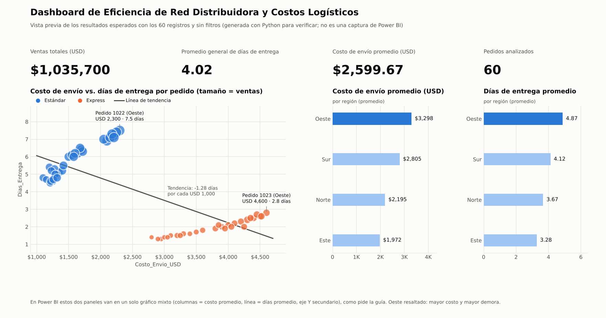

# Análisis crítico: eficiencia logística

Este es el párrafo que va dentro del reporte (ya está puesto como cuadro de texto en el proyecto de Power BI). Debajo están las cifras que lo respaldan, todas calculadas con los 60 registros y sin filtros.

---

## Párrafo para el reporte

> **¿Qué región presenta ineficiencias críticas de entrega a pesar de sus altos costos operativos?**
>
> La región **Oeste** es la que presenta ineficiencias críticas de entrega: tiene el costo de envío promedio más alto (USD 3,297.50; 67 % más que Este, con USD 1,972.14) y, aun así, el mayor tiempo promedio de entrega (4.87 días frente a 3.28 en Este). La ineficiencia se repite en ambos servicios: su Express cuesta en promedio USD 4,415 (49 % más que el Express de Este) pero tarda 2.55 días (84 % más que los 1.38 días de Este), y su Estándar tarda 7.19 días con un costo 78 % mayor que el Estándar de Este.
>
> **¿Cómo se comportan los valores atípicos en la nube de dispersión?**
>
> En la nube de dispersión se forman dos grupos: Estándar (USD 1,100–2,300; 4.5–7.5 días) y Express (USD 2,800–4,600; 1.3–2.8 días). La línea de tendencia tiene pendiente negativa (≈ −1.3 días por cada USD 1,000 adicionales): el Express sí reduce el tránsito (de 5.83 a 1.95 días, con un sobrecosto de ≈ USD 561 por día ahorrado). Pero dentro de cada grupo la relación se invierte: los envíos más caros también son los más lentos. Los valores atípicos se ubican en el extremo superior derecho de cada nube y son del Oeste (pedidos 1022: USD 2,300 y 7.5 días; 1023: USD 4,600 y 2.8 días), con las burbujas más grandes (ventas de hasta USD 25,100). En otras palabras, la región que más vende y más paga por envío es la que recibe el peor servicio. Se recomienda auditar rutas, transportistas y bodegas del Oeste antes de ampliar allí el uso del Express.

---

## Cifras de respaldo

### Promedios por región (lo que muestra el gráfico mixto)

| Región | Costo de envío promedio (USD) | Días de entrega promedio | Pedidos |
|---|---:|---:|---:|
| **Oeste** | **3,297.50** | **4.87** | 16 |
| Sur | 2,805.00 | 4.12 | 16 |
| Norte | 2,195.00 | 3.67 | 14 |
| Este | 1,972.14 | 3.28 | 14 |

El orden es el mismo en las dos métricas: cuanto más cara es la región, más tarda. El Oeste ocupa el primer lugar en ambas.

### Región × tipo de envío

| Región | Tipo | Costo prom. (USD) | Días prom. | Rango de días |
|---|---|---:|---:|---|
| Este | Estándar | 1,226.25 | 4.70 | 4.5 – 4.9 |
| Este | Express | 2,966.67 | 1.38 | 1.3 – 1.5 |
| Norte | Estándar | 1,310.00 | 5.21 | 5.0 – 5.5 |
| Norte | Express | 3,375.00 | 1.62 | 1.5 – 1.8 |
| Sur | Estándar | 1,622.50 | 6.21 | 6.0 – 6.5 |
| Sur | Express | 3,987.50 | 2.02 | 1.9 – 2.2 |
| **Oeste** | **Estándar** | **2,180.00** | **7.19** | 6.9 – 7.5 |
| **Oeste** | **Express** | **4,415.00** | **2.55** | 2.3 – 2.8 |

### ¿El Express justifica su precio?

| Tipo | Costo prom. (USD) | Días prom. | Costo / ventas |
|---|---:|---:|---:|
| Estándar | 1,584.69 | 5.83 | ≈ 7 % |
| Express | 3,759.64 | 1.95 | ≈ 28 % |

- El Express ahorra 3.88 días por pedido a cambio de USD 2,175 más, unos **USD 561 por día ahorrado**.
- Sí reduce los tiempos en todas las regiones, pero el Express del Oeste (2.55 días) es el más lento y el más caro de todos.

### Línea de tendencia (gráfico de dispersión)

- Con las series combinadas (opción por defecto de Power BI) la pendiente es de **−0.00128 días por USD**, es decir, unos −1.28 días por cada USD 1,000 (correlación r = −0.73).
- Si se separa por tipo de envío, la pendiente pasa a ser **positiva** en ambos grupos (r ≈ 0.96): dentro de cada servicio, pagar más no acelera la entrega. Lo que hay detrás es la geografía, porque las regiones caras (Oeste y Sur) son también las lentas.

### Sobre los valores atípicos

Con el criterio estadístico de 1.5 × rango intercuartílico (RIC), ningún punto queda fuera de rango dentro de su grupo. Los "atípicos" de este caso son **analíticos**: puntos que rompen lo esperado (más costo debería significar más rapidez). Son los pedidos del Oeste en el extremo superior derecho de cada nube, sobre todo el **1022** (el Estándar más caro y más lento) y el **1023** (el Express más caro y más lento). Además tienen burbujas grandes, porque el Oeste concentra el 30.8 % de las ventas y el 33.8 % del gasto en envíos.

### Tarjetas KPI (sin filtros)

- Suma de Ventas_USD: **USD 1,035,700**
- Promedio de Dias_Entrega: **4.02 días**

